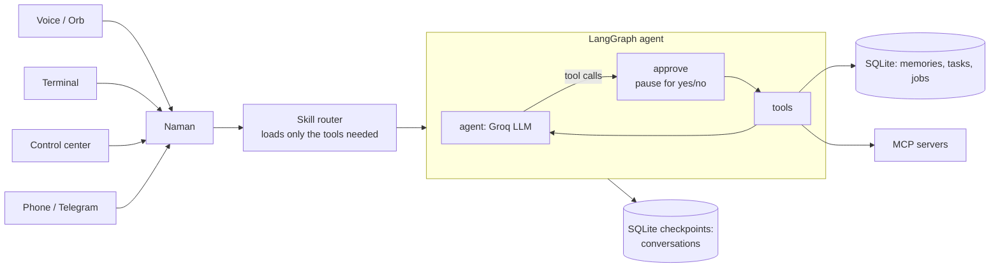

# Naman

A personal AI assistant for your Windows laptop and your phone. Talk to it out loud
("Jarvis, open VS Code"), type to it, or message it on Telegram. It remembers you, keeps
your tasks organised by project, controls the laptop, hunts for jobs while you sleep, and
asks before anything risky.

It sits in the corner of your screen as a small always-on-top orb. Say **"Jarvis"** (or
"Hey Jarvis") any time.

```
"Jarvis"                         *beep*
you>    Open Spotify and play lo-fi.
naman> Opened Spotify, playing lo-fi beats.
you>    Add a task to finish my portfolio by Friday.
naman> Task added to Portfolio: finish it, due Friday.
you>    Shut down the laptop.
naman> Should I shut down? Say yes or no.
```

Runs on **free tiers**: [Groq](https://console.groq.com) for the language model and speech
to text, an offline Whisper model for the wake word, and Microsoft Edge voices for speech.

---

## Quick start

### 1. What you need

| | Required? | Notes |
|---|---|---|
| Windows 10 / 11 | yes | Laptop control (apps, volume, windows) uses Windows APIs |
| [Python 3.11+](https://www.python.org/downloads/) | yes | Tick "Add Python to PATH" when installing |
| [Git](https://git-scm.com/downloads) | yes | To clone the repo |
| A free [Groq API key](https://console.groq.com/keys) | yes | Sign in, "Create API key" |
| A microphone and speakers | for voice | Text chat works without them |
| [Node.js](https://nodejs.org) | optional | Only for MCP servers started with `npx` |
| Google Chrome | optional | Web pages and the control center open in it; set `NAMAN_BROWSER=default` otherwise |
| [Claude Code](https://docs.claude.com/en/docs/claude-code) | optional | Only for "build X with Claude Code" |

### 2. Install

Open PowerShell and run:

```powershell
git clone https://github.com/<your-username>/naman.git
cd naman

python -m venv .venv
.\.venv\Scripts\Activate.ps1          # if blocked: Set-ExecutionPolicy -Scope CurrentUser RemoteSigned
pip install -e ".[voice]"             # use ".[dev]" to also get pytest; "." alone for text only
```

### 3. Configure

```powershell
copy .env.example .env
notepad .env
```

Set at least:

```ini
GROQ_API_KEY=gsk_...        # your free key
NAMAN_USER_NAME=Alex        # what Naman calls you
```

Everything else in `.env` is optional and explained in the file (voice, wake word,
Telegram, browser, the fallback model...).

### 4. Run it

```powershell
naman chat          # text chat in the terminal: the quickest way to check it works
naman mic-test      # check your mic, speech to text and the voice
naman start         # the full thing: orb + voice + control center + automation + Telegram
```

Then say **"Jarvis"**, wait for the beep, and speak. Or say it all at once: "Jarvis, what's
the weather tomorrow?"

To start it with Windows: `naman startup on` (`off` / `status`).

### 5. Tell it about yourself

Naman creates a `data/` folder on first run. **Everything personal stays in there** (and
in `.env`). Neither is ever committed.

| File | What to put in it |
|---|---|
| `data/profile.md` | Who you are: skills, projects, work, preferences. Sent with every request, so no secrets. Lines starting `Private:` are never used in emails |
| `data/jobs.json` | Job search: `roles`, `locations` (your cities), `home` (words in a job's location meaning "near you", e.g. `["bengaluru", "karnataka"]`), `country`, `skills`, `experience_years` |
| `data/outreach.json` | Application emails: `from_name`, `gmail_account`, `signature`, résumé PDFs (`resume_files`, `master_resume`) |
| `data/automation.json` | Times for the nightly job search, morning briefing and evening check-in; `github_user` to get star/fork alerts |

The JSON files are created with sensible defaults on first use. Edit them, then restart.

---

## Commands

| Command | Does |
|---|---|
| `naman start` | Orb + voice + control center + automation + Telegram (`--no-greet` to skip the greeting) |
| `naman chat` | Terminal chat |
| `naman voice` | Voice in the terminal (`--ptt` for push-to-talk, `--voice en-IN-PrabhatNeural`) |
| `naman open` | Open the control center (starts Naman if it isn't running) |
| `naman control` | The control center only, without the orb |
| `naman shortcut` | A "Jarvis Control Center" icon on your desktop |
| `naman telegram-setup` | Connect your phone |
| `naman jobs-refresh` | Search for jobs now |
| `naman mcp` | Connect your MCP servers and list their tools |
| `naman tasks` / `naman memories` | What's on your list / what it remembers |
| `naman startup on` | Start with Windows |
| `.\scripts\restart.ps1` | Restart a running Naman after changing code or settings |

---

## What you can say

| Skill pack | Examples |
|---|---|
| Apps & web | "Open VS Code", "close Chrome", "switch to Spotify", "open my Downloads" |
| Laptop | "Close this tab", "volume 30", "mute", "next song", "brightness 60", "take a screenshot", "how's my battery?", "type hello world", "press ctrl+s", "lock the laptop", "shut down" (asks first, 30 s grace; "cancel shutdown") |
| Knowledge | "Weather tomorrow?", "today's headlines", "who won yesterday's match?" (live web search) |
| Media | "Play old songs" (Spotify), "play lo-fi on YouTube" |
| Multi-step | "Open Spotify and play old songs", "close Chrome, mute and lock the laptop" |
| Reminders | "Remind me in 20 minutes to stretch", "remind me at 6 pm to call mom" |
| Routines | "When I say *work mode*, open VS Code and play lo-fi", then just say "work mode" |
| Tasks & schedule | "I need to finish the report by Sunday", "I finished the report", "what next?", "weekdays 10 to 6 I'm at work" |
| Jobs | "Show jobs above 70", "any remote ML openings?", "details of job 12", "mark it applied" |
| Build | "Build an expense tracker in C:/code/expense-tracker with Claude Code" (asks first) |
| Files | "Open the internship excel on my desktop" (OneDrive Desktop included) |
| Messaging | "WhatsApp my brother that I'm running late" (opens a draft; you press send) |
| Memory | "Remember my brother's number is ...", "what do you know about me?" |
| MCP servers | Anything your connected servers do: files, GitHub, any API |

### The orb

| Do | To |
|---|---|
| Click | talk without the wake word |
| Double-click | type a command |
| Drag | move it (remembered) |
| Right-click | talk, type, control center, mic off, start with Windows, quit |

Its colour shows what it's doing: teal waiting, blue listening, amber thinking, violet
running steps, green speaking, grey mic off. When it asks you a question, just answer:
it listens for 6 s without the wake word.

### Control center

Right-click the orb, **Control center** (or say "open control center"). A local web app
on `127.0.0.1` only, protected by a secret key:

| Page | What's there |
|---|---|
| Overview | Now/next from your schedule, tasks, best new openings, recent builds |
| Jobs | Openings with a **fit score** and why, skills (yours highlighted), salary, contact / how to apply; filter by Near me / Remote / Freelance / Internship |
| Posts | New AI tools, launches and hiring posts |
| Companies | Companies with their published hiring emails and HR LinkedIn profiles; CSV / Excel export |
| Outreach | Application emails Naman drafted from your real profile |
| Tasks & schedule | Open tasks and a weekly timetable |
| Claude Code | Start a build, see reports |
| Memory | Your profile and every remembered fact (forget any) |

Plus a chat box that shares one conversation with voice and Telegram. Light and dark themes.

### Jobs

Searched twice a day (and whenever you ask) from public LinkedIn listings and hiring posts,
Freelancer.com, Truelancer, Remotive and Jobicy. Each job's details are extracted once by a
small model; the **fit score** is plain arithmetic you can check: skills 45, role 25,
experience 20, location 10, plus the bonuses in `prefer` (`home`, `remote`, `freelance`,
`internship`). Only jobs from the last 7 days are kept.

For each job you can see how well each of your résumés matches (ATS-style), make a
**tailored one-page résumé** (it may reorder and reword, never invent: claims not backed by
your material are removed and listed), and write a reply or email. Emails are only drafted
by default: "Open in Gmail" opens them filled in, and you send them yourself.
(`auto_send` in `data/outreach.json` is off unless you turn it on.)

### While you sleep

From `data/automation.json` (times editable): job search at 02:00 and 14:00, posts at 02:30,
a morning briefing at 08:00, an evening check-in at 21:30. A slot missed while the laptop was
off runs when Naman starts. The laptop has to be on.

---

## Phone (Telegram)

1. In Telegram, message **@BotFather**, send `/newbot`, pick a name, copy the token.
2. Run `naman telegram-setup`, paste the token, then send your bot any message. It saves
   your user id, so **only you** can use the bot.
3. Restart Naman (`naman start`). The bot runs inside it, with the same brain and conversation.

Commands: `/next`, `/tasks`, `/jobs`, `/brief`, `/status`, `/screenshot`, `/help`. Laptop
actions arrive with **Approve / Deny** buttons. Voice notes work too.

---

## MCP servers (optional)

Plug in any [MCP](https://modelcontextprotocol.io) server, using the same format as Claude Desktop:

```powershell
copy mcp_servers.example.json mcp_servers.json   # edit paths, enable servers
naman mcp                                        # connect and list every tool
```

| Key | Meaning |
|---|---|
| `approval` | `writes` (default): ask before any tool not marked read-only. `always`: ask every time. `never`: trust fully |
| `tools` | Allow-list. Each tool adds to every request, so keep only what you use |
| `enabled` | `false` keeps the entry without starting it |

The example gives the official filesystem server access to `~/Documents`. Change the
folder to one you want Naman to read. A server that fails to start is skipped.

---

## Voice settings

| `.env` | Default | |
|---|---|---|
| `NAMAN_WAKE_WORD` | `Jarvis` | Any word works; it's spotted by an offline Whisper model |
| `NAMAN_VOICE` | `en-GB-RyanNeural` | Any Edge neural voice, e.g. `en-IN-NeerjaNeural`, `en-US-GuyNeural` |
| `NAMAN_STT_LANGUAGE` | `en` | `hi` for Hindi, `auto` to let Whisper guess |
| `NAMAN_VOCAB` | | Names it keeps mishearing (your projects, company), comma-separated |

If it misses the wake word often, try `naman voice --wake-model base.en` (slower, more accurate).

---

## Safety and privacy

- **Asks first** before shutting down, restarting, MCP write tools and Claude Code builds.
  `NAMAN_CONFIRM_ACTIONS=true` makes it ask for everything.
- Never opens files that run code (`.exe`, `.bat`, `.ps1`...), never presses `alt+f4` or
  `ctrl+alt+delete`, and WhatsApp messages are drafts you send yourself.
- The control center listens on `127.0.0.1` only and needs a secret key.
- The Telegram bot ignores everyone except the user ids you allow.
- Your profile, memories, résumés and settings stay in `data/` on your machine. What you
  say, and the relevant parts of your profile, are sent to Groq to get answers.

---

## Architecture



- **A skill router** picks which of the ~56 tools to send per request, so a free Groq quota
  lasts all day. Obvious commands ("volume 30") skip the router's model call.
- **Approval is its own graph step**, so a resumed conversation never re-runs a tool that
  already ran.
- **Falls back** to a smaller model when the main one hits Groq's daily limit.

---

## Tests

```powershell
pip install -e ".[dev]"
pytest          # offline: a scripted fake model drives the real graph, tools and storage
```

## Troubleshooting

| Problem | Try |
|---|---|
| `naman` is not recognised | Activate the venv first: `.\.venv\Scripts\Activate.ps1` |
| `Activate.ps1` is blocked | `Set-ExecutionPolicy -Scope CurrentUser RemoteSigned` |
| Rate limit / quota errors | Free tier limits; it falls back automatically. Set `NAMAN_MODEL=openai/gpt-oss-20b` for more headroom |
| Doesn't hear "Jarvis" | `naman mic-test`; check the right mic is the Windows default; try `--wake-model base.en` |
| Logs | `data/naman.log` (when started with Windows there's no console) |

## License

MIT. Use it, change it, share it.
